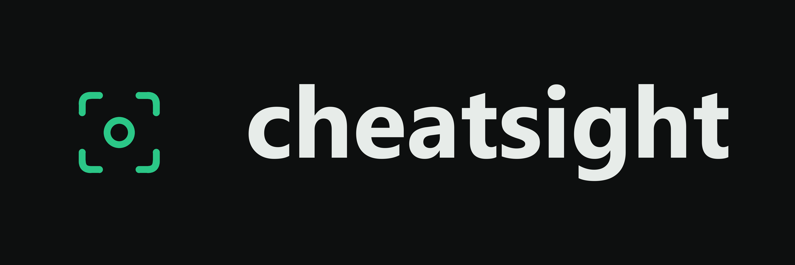

# CheatSight

Google Forms tests and Google Meet sessions with transparent activity monitoring and downloadable facilitator logs. Built for Render's free Node web services. No persistent disk, database service, API key, or account system is required.

## How to use CheatSight

- **Teachers / facilitators:** [Create a session, invite students, monitor activity, and download logs](docs/FACILITATOR-GUIDE.md).
- **Students:** [Install the Google Meet extension in Chrome or Edge and connect to your session](docs/STUDENT-GUIDE.md). Google Forms Test sessions do not require an extension.
- **Download:** [CheatSight Chrome / Edge extension ZIP](https://github.com/Tskk-dev/CheatSight/raw/refs/heads/main/public/CheatSight-extension.zip). This is the unpacked testing version, not a browser-store listing.

## Start locally

Run `npm ci` once if dependencies are not installed, then `npm run local` (or `npm run dev`). On Windows, double-click `Start-CheatSight.cmd`. Open **http://localhost:3000** and keep the server running. One command builds the current app and starts both the page and its API.

The dashboard starts empty. Choose **Start local test** to create a real monitored session without a Google Forms link. Open its student link in another tab, enter a name, acknowledge monitoring, switch away and return, then check the facilitator dashboard and download the real event log. The local test form is served inside an iframe; its answers are not saved. Google Forms sessions use the same monitoring flow.

To use your own form, choose **Create session** and paste its published Google Forms responder link. Google Forms still needs an internet connection and the correct Google account permissions.

## Deploy on Render

1. In Render, choose **New → Blueprint** and connect **Tskk-dev/CheatSight**.
2. Render reads `render.yaml`. Keep the **Free** web service plan and deploy.
3. Open the generated `onrender.com` URL. Choose Test or Google Meet, add the appropriate link, and share the generated student link.

Alternatively, create a **Node Web Service** using this repository:

| Setting | Value |
| --- | --- |
| Root directory | Leave blank |
| Build command | `npm ci --include=dev && npm run build` |
| Start command | `npm start` |
| Node version | `24.21.0` (set by `.node-version`) |
| Health check path | `/health` |
| Instance plan | Free |
| Persistent disk / external database | None |

Render provides the `PORT` and `RENDER_EXTERNAL_URL` variables automatically. For another host or a custom canonical URL, set `PUBLIC_URL` to the application's HTTPS origin. Run exactly one server instance: each process has its own temporary session memory.

Render's free service can sleep after inactivity and can restart. **All session records live in server memory and disappear when the service restarts, redeploys, or sleeps.** Records also expire after 24 hours. See [Render's free service limits](https://render.com/docs/free). This is intentional: the facilitator downloads the logs they want to keep.

## Facilitator flow

1. Create a session and choose **Test** or **Google Meet**. Test requires a full published responder URL like `https://docs.google.com/forms/d/e/FORM_ID/viewform`. Google Meet requires a meeting URL like `https://meet.google.com/abc-defg-hij` and does not require a Google Form. Test sessions can optionally include mouse activity on CheatSight. Form editor URLs and `forms.gle` short links are rejected; use the full responder link.
2. Copy the student link. Students enter a display name and acknowledge the monitoring notice before collection starts.
3. Keep the dashboard open to see activity refresh every five seconds. Select a student for their event timeline. Search or filter the student table.
4. Choose **Download logs** to save the complete chronological event log as CSV. **Session options → Download complete report (JSON)** also includes student summaries and session details. Downloads include every student in the selected session, regardless of the current table filter.
5. End the session to stop collection. Download before the server resets. Ending a session does not close its Google Form.

Your browser receives a random, HttpOnly facilitator cookie. Only that browser can view or end its sessions. Other facilitators get separate workspaces. There is no sign-up, password, or account recovery. Clearing cookies or switching browsers loses facilitator access to existing sessions. Share **student links only**, not browser cookies. Students cannot use their participant tokens to read facilitator logs.

The initial dashboard is empty. `/join/demo` is a local sample student experience; it does not send monitoring data to the server.

## Google Meet sessions

Select **Google Meet** in the session type selector and paste the meeting link. No Google Form is required. Meet opens in a separate tab. To monitor whether students switch away from the assigned Meet tab/window, each student needs the included **Chrome/Edge extension**. Google API credentials are not required.

Share the [step-by-step student installation guide](docs/STUDENT-GUIDE.md) before the session. It covers download, extraction, separate Chrome and Edge installation steps, connecting, finishing, and troubleshooting.

The student page links to `CheatSight-extension.zip` and explains installation. Unzip it, open `chrome://extensions` or `edge://extensions`, enable Developer mode, choose **Load unpacked**, and select the unzipped folder. Open the extension, paste the CheatSight student session link, enter a name, acknowledge monitoring, and grant access to that specific CheatSight site. The host permission for Google Meet allows reading only matching Meet tab URLs; no broad browsing-history permission or content script is requested. The optional site permission is requested for the chosen CheatSight origin when connecting, not all websites at installation.

Once connected, open the assigned call. The extension sends an active/away event when the assigned Meet tab/window gains or loses focus. Switching to another tab, another browser window, another app, minimizing, or closing the assigned tab is reported as away once the session has started observing Meet. A different Meet meeting does not count as the assigned meeting. Before the assigned tab is first active, the dashboard shows **Waiting for Meet**. Use **Finish & stop monitoring** in the extension when done. If the server is offline, the extension queues events in browser-session memory and retries. Restarting the browser clears that pairing; connect again. Chrome may delay the 30-second heartbeat; a stale extension heartbeat becomes **No recent signal** after 90 seconds. The teacher can end the session; the extension stops syncing when it receives that response.

CheatSight does not read audio, video, chat, answers, mouse movements, keystrokes, or URLs of other websites. A visible meeting tab does not prove attendance or attention, and away events do not prove cheating. Monitoring is browser-reported and can be disabled or interrupted by the student. Uninstalling/disabling the extension, a terminated browser, and network outages can interrupt or lose the final events. Logs remain temporary on the server. The ZIP is an unpacked extension for testing; it is not published in either browser's extension store, and managed school devices may block unpacked installation. CSV logs identify the session type; JSON includes the Meet link and monitoring source.

The extension source is in `extension/`. After edits, run `python scripts/package-extension.py` to refresh the downloadable ZIP before building. `npm test` executes the actual extension background against simulated browser tab/window APIs and the real HTTP backend. Installation and physical tab switching still require a live Chrome/Edge check.

Test mode continues to use the embedded Google Forms view. The local practice form is also a Test session.

## What is monitored

- Page hidden/visible events, tab-exit count, and time away.
- Window focus changes, separated from focus entering the Google Forms iframe.
- Optional pointer movement counts **outside** the embedded form, sampled at most ten times per second and sent in batches with ten-second heartbeats.
- Join time, connection recency, optional fullscreen changes, and student-declared completion.

Google Forms is cross-origin; Google Meet runs in a separate tab with optional student-installed extension monitoring. The surrounding page cannot read answers, keystrokes, clicks, mouse movement inside the iframe, or whether the form was submitted. No screenshots, cursor coordinates, other-tab URLs, or screen content are collected. Restricted forms may require the student's Google account. Students must submit inside Google Forms before finishing the monitoring session. Fullscreen is optional; the planned duration is a guide, not an automatic timer.

Activity is browser-reported and may be incomplete, blocked, or disabled. A hidden page can mean a tab switch, minimized browser, or app switch. It cannot prove cheating or attention. “No recent signal” may reflect disconnection or browser timer throttling. Unsent events retry while the tab stays open; a browser crash or closing while offline may lose the last events. Local student counters reset on reload; synced server events remain until the temporary store resets or expires. Sessions accept up to 300 joins; classroom-scale load has not been tested. The dashboard currently polls the complete event history, suitable for small sessions; add aggregation before larger deployments.

## Run locally

Requires Node.js 24.13 or later in the Node 24 release line.

```sh
npm ci
npm run build
npm start
```

Open `http://localhost:3000`. The server serves the built React app and its monitoring API. `npm run local` and `npm run dev` build and start both together; restarting the command applies source edits. Restarting the backend intentionally clears all sessions.

## Verify

```sh
npm run build
npm test
```

Checks cover form URL validation, focus/visibility summaries, CSV escaping, JSON report content, facilitator isolation, participant tokens, acknowledgment, duplicate retries, completion, ending, security headers, app routes, and loss of records on a server reset. Live Google Forms access and an actual Render deployment require the owner's form and hosting account.

Browser behavior: [MDN Page Visibility API](https://developer.mozilla.org/en-US/docs/Web/API/Page_Visibility_API). Embedding setup: [Google Forms publishing and embedding](https://support.google.com/docs/answer/2839588).
